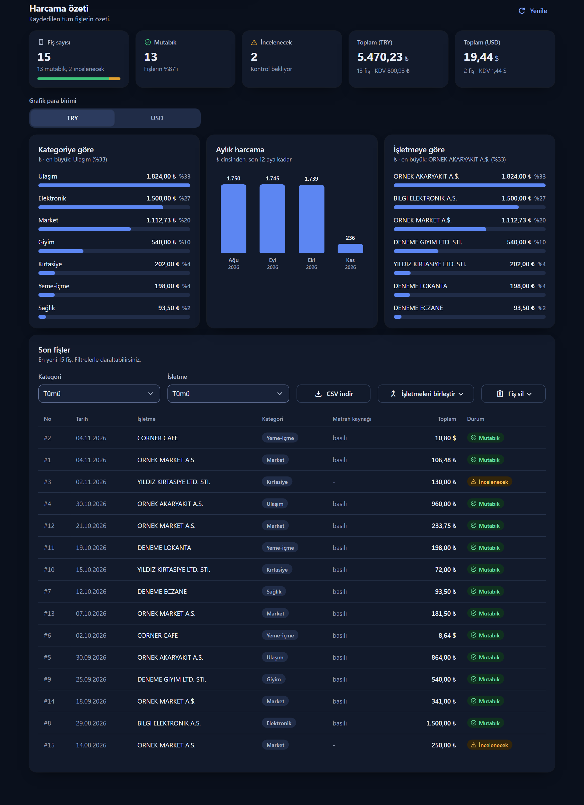
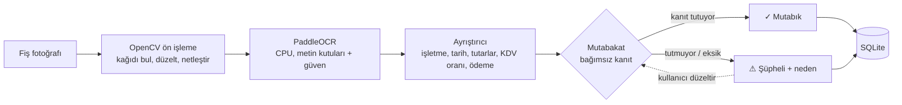

# Mutabık

**Okuduğunu kanıtlayan fiş OCR'ı.** Fiş fotoğrafını okur, sonucu **Matrah + Vergi = Toplam** kuralıyla bağımsız olarak doğrular; tutmayanı nedeniyle birlikte "şüpheli" işaretler. Türkçe ve İngilizce fişleri okur. Ücretli API, bulut ve GPU gerektirmez.

*English: a receipt OCR pipeline that cross-checks every reading (subtotal + tax = total, cash − change = total) and flags only the receipts whose numbers don't add up. Python, FastAPI, PaddleOCR (CPU), OpenCV, SQLite, Streamlit, mobile PWA. Runs fully local and free.*

> Fiş → OpenCV ön işleme → PaddleOCR (CPU) → kural tabanlı ayrıştırıcı → **mutabakat** → SQLite → Streamlit paneli ve mobil PWA

## Ekran görüntüleri

Görüntülerdeki fişler tamamen **kurgusaldır** (işletmeler, tutarlar ve tarihler uydurma; fotoğraflar sentetik) ve gerçek OCR hattından geçirilmiştir.

**Masaüstü: okuma, mutabakat ve düzeltme.** Matrah 100 + KDV 20 = 120 ama toplam 130 okundu: fiş "incelenecek" olur, neden yazılır, OCR kutuları güven rengiyle çizilir, kullanıcı tek formda düzeltir.


**Masaüstü: harcama özeti.** Para birimleri asla toplanmaz; "matrah kaynağı" sütunu her fişin hangi yöntemle doğrulandığını gösterir.


<details><summary>Koyu tema</summary>



</details>

**Telefon (PWA): çek, şüphelileri incele, düzelt.**


## Arka planda ne oluyor?



1. **Ön işleme:** fişin kenarları bulunup perspektif düzeltilir, kontrast artırılır. Yan ya da ters çekilmişse ve toplam bulunamadıysa 4 yön denenir.
2. **OCR:** PaddleOCR her satırı kutu ve güvenle verir. OCR **yanılabilir**: `Ş` → `$`, `*94,00` → `494,00`.
3. **Ayrıştırma:** kurallar ve uzamsal düzen (aynı satırdaki etiket + tutar) ile işletme, tarih, matrah, KDV, toplam, KDV oranı ve ödeme bulunur.
4. **Mutabakat, "kanıt karar verir":** sonuç `Matrah + KDV = Toplam` ile doğrulanır. Matrah basılı değilse `KDV %10` oranından, toplamdan bağımsız türetilir. İkinci bağımsız kanıt ödemedir (`nakit − para üstü`). Kanıt çelişirse fiş "şüpheli" olur ve **nedeni yazılır**; eksik veriyle asla "doğrulandı" denmez.

Somut örnek (yukarıdaki sonuç ekranı): OCR `matrah 100,00`, `KDV %20 → 20,00`, `toplam 130,00` okudu. `100 + 20 = 120 ≠ 130` olduğu için sistem tutarı sessizce "düzeltmez", fişi şüpheli işaretleyip farkı (`+10,00`) gösterir. Hangi rakamın yanlış olduğuna insan bakar. Aynı mantıkla `*94,00`'ı `494,00` okuyan OCR, ödeme satırlarıyla (`204 − 110 = 94`) çapraz kontrolde yakalanır.

Tüm aşamalar, tasarım kararları ve sınırlar: [`docs/ARCHITECTURE.md`](docs/ARCHITECTURE.md).

## Neden ilginç?

Çoğu fiş OCR projesi metni okuyup bırakır. Burada asıl iş **okunanın doğruluğunu kanıtlamak**:

- Her fişte `Matrah + Vergi ≈ Toplam` (tolerans 0,02) kontrol edilir. Tutarsızsa fiş **incelemeye** gider ve nedeni yazılır; eksik veriyle asla "doğrulandı" denmez.
- Matrah basılı değilse (Türk kasa fişlerinde çoğu zaman böyledir) `KDV %10 9,68` satırından **toplamdan bağımsız** türetilir; oran satırı da yoksa KDV oranının fişteki oranlarla uyumu kontrol edilir. `Toplam − KDV` ile "matrah" üretip her fişi sahte yere onaylamaz; fişin **hangi yöntemle** doğrulandığı arayüzde yazar.
- Para hesabı `Decimal` ile yapılır, `float` hatası yoktur.
- İkinci, bağımsız kontrol: **ödeme** (`nakit − para üstü` veya kart) toplama eşit olmalı. OCR'ın `*94,00`'ı `494,00` okuması gibi hatalar bu çapraz kanıtla yakalanır ve düzeltilir (kullanıcıya bildirilerek).
- Okuma bozuksa, yan/ters çekilmiş fiş otomatik döndürülüp yeniden okunur.
- Kullanıcı yanlış okunan değeri arayüzden düzeltir; durum anında yeniden hesaplanır.

## Özellikler

- Kamera, dosya yükleme veya örnek fiş; okunan metin kutuları güven rengiyle çizilir
- Mutabakat kartı (mutabık / şüpheli), düzeltme formu, kategori seçimi
- Otomatik kategori (market, yeme-içme, kırtasiye, ulaşım, sağlık...); kategoriyi düzeltince sistem **işletme için öğrenir**
- Aynı işletmenin farklı OCR yazılışları (`A.S` / `A.S.` / `A.Ş.`) tek işletme sayılır; elle birleştirme ve işletme/kategori filtresi
- Dashboard: para birimine göre toplamlar, kategori / ay / işletme grafikleri (para birimleri asla toplanmaz)
- Excel uyumlu CSV dışa aktarma (Türkçe Excel için `;` ve ondalık virgül), silme
- Açık ve koyu görünümü sistemden izleyen, telefonda da çalışan arayüz; WCAG kontrastı testle doğrulanmış ([tasarım sistemi](docs/DESIGN.md))
- Tek komutla Docker kurulumu (OCR modelleri imaja gömülü)
- Mobil PWA: büyük "Fiş çek" düğmesi, art arda çekim + arkada okuma, yalnızca şüphelileri sırayla düzeltme, bulanık/karanlık uyarısı, ana ekrana eklenebilir
- 239 otomatik test (157 backend, 82 frontend) + doğruluk ölçüm aracı + CI

## Hızlı başlangıç

**Docker (önerilen)**

```bash
docker compose up --build
```

Arayüz: http://localhost:8501 · API dokümanı: http://localhost:8000/docs (ilk derleme birkaç dakika sürer)

**Elle (Python 3.10/3.11)**

```bash
cd backend
python -m venv .venv && .venv/Scripts/activate      # Linux/macOS: source .venv/bin/activate
pip install -r requirements.txt
python -m app.main                                   # http://127.0.0.1:8000
```

```bash
cd frontend
python -m venv .venv && .venv/Scripts/activate
pip install -r requirements.txt
streamlit run app.py                                 # http://localhost:8501
```

## Telefondan kullanım

Telefon için ayrı, ince bir arayüz vardır: **mobil PWA** (`/m/`, API ile aynı sunucudan gelir). Büyük "Fiş çek" düğmesi kamerayı açar, fotoğraf telefonda küçültülüp yüklenir, art arda çekebilirsiniz (okuma arkada sürer). Sonuç "✓ Mutabık" ya da "⚠ Şüpheli: neden" olarak görünür; şüphelileri **İncele** sekmesinde sırayla düzeltirsiniz. Bulanık/karanlık fotoğraf için uyarı verir.

- Aynı Wi-Fi'de `http://<bilgisayar-IP>:8000/m/` açılır ve çalışır; ancak tarayıcı HTTP'de "uygulamayı yükle" ve çevrimdışı kabuğa izin vermez.
- Gerçek HTTPS için [Tailscale](https://tailscale.com) (ücretsiz, hesap gerekir): bilgisayara ve telefona kurun, yönetim panelinde MagicDNS ile HTTPS sertifikalarını açın, sonra bilgisayarda:

```bash
tailscale serve --bg 8000      # https://<bilgisayar>.<tailnet>.ts.net/m/ (yalnızca sizin cihazlarınız)
tailscale serve reset          # kapatmak için
```

Telefonda Chrome'da bu adresi açıp menüden **Uygulamayı yükle** deyin. Adres yalnızca Tailscale ağınızdaki cihazlara açıktır (herkese açık tünel değildir). Uygulamada kimlik doğrulama olmadığı için Cloudflare Tunnel gibi herkese açan çözümler önerilmez.
- Masaüstü arayüzündeki (Streamlit) "Kamera" sekmesi de aynı HTTPS adresiyle çalışır: `tailscale serve --bg --https=8443 8501`.

## Testler

```bash
cd backend && pip install -r requirements-dev.txt && python -m pytest
cd frontend && python -m pytest
```

Backend testleri sahte OCR motoruyla çalışır (model indirmeden saniyeler içinde biter), ama veritabanı, görüntü ön işleme ve HTTP katmanı gerçektir.

## Doğruluk ölçümü

```bash
cd backend
python -m eval.evaluate --out eval/RESULTS.md              # örnek fişler + sentetik bozulmalar
python -m eval.evaluate --dir benim_fislerim               # kendi fişleriniz + labels.json
```

Son sentetik çalıştırma (3 kurgusal fiş × 8 varyasyon: döndürme, bulanıklık, gürültü, loş ışık, eğiklik): `eval/RESULTS.md`.
**Dürüst not:** bu, gerçek dünya doğruluğu değil, dayanıklılık kontrolüdür. Gerçek (kişisel verisi kapatılmış) fişlerle ölçüm sonucunu buraya ekleyin.

## Dokümantasyon

- [`docs/ARCHITECTURE.md`](docs/ARCHITECTURE.md): sistem arkada nasıl çalışıyor (aşamalar, tasarım kararları, sınırlar)
- [`docs/DESIGN.md`](docs/DESIGN.md): arayüz tasarım sistemi (Apple HIG ve Emil Kowalski ilkelerinden kararlar, renk/kontrast tablosu, tipografi, hareket)
- API: `/docs` (Swagger)

## Teknoloji

Python 3.11 · FastAPI · SQLAlchemy 2 (async) + SQLite · Pydantic v2 · OpenCV · PaddleOCR (PP-OCR, CPU) · Streamlit · pytest · Docker Compose · GitHub Actions

## Bilinen sınırlar

Kalem (ürün satırı) bazlı çıkarım yok; kimlik doğrulama yok (tek kullanıcılı demo); doğruluk az sayıda gerçek fişle ölçüldü. Ayrıntı: [mimari belgesi](docs/ARCHITECTURE.md#8-bilinen-sınırlar-dürüstçe).

Örnek fişler tamamen kurgusaldır.

## Lisans

[MIT](LICENSE)
