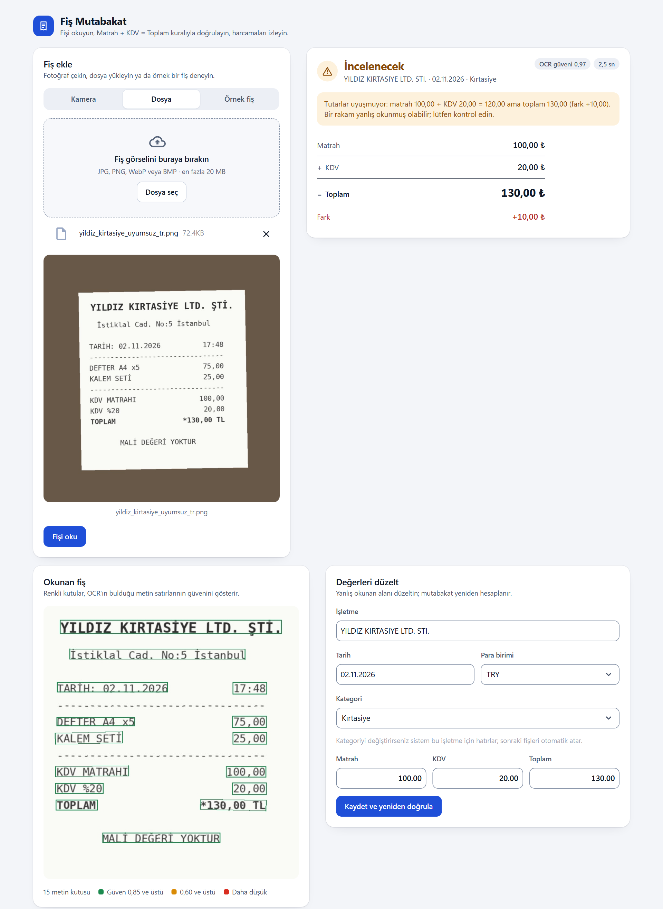
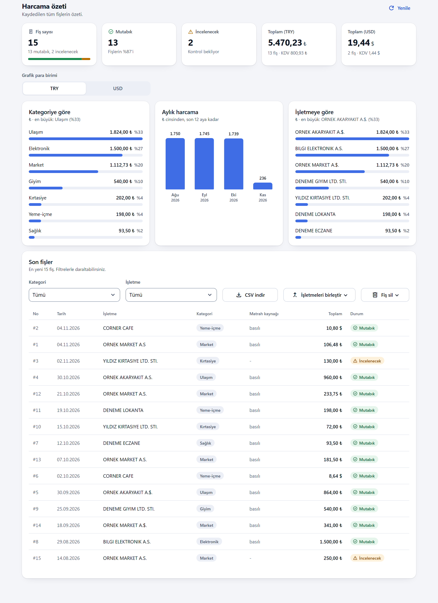
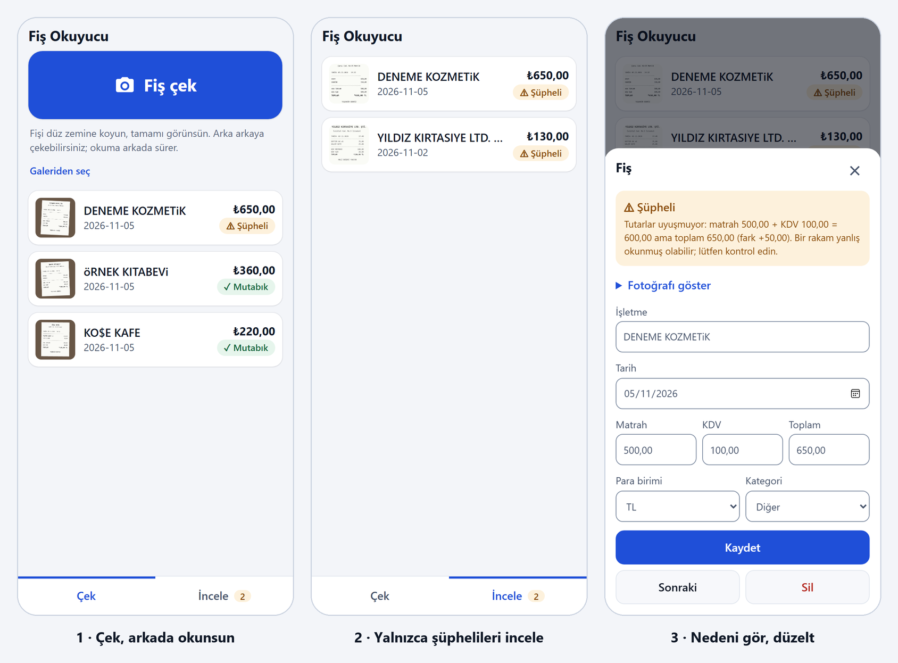
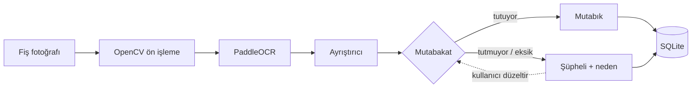

# Mutabık

**Okuduğunu doğrulayan fiş OCR'ı.** Fiş fotoğrafını okur, sonucu **Matrah + KDV = Toplam** kuralıyla kontrol eder; tutmayan fişi nedeniyle birlikte "şüpheli" işaretler. Türkçe ve İngilizce fişleri okur. Ücretli API, bulut ve GPU gerektirmez.

*English: a receipt OCR pipeline that cross-checks each reading (subtotal + tax = total, cash − change = total) and flags only the receipts whose numbers don't add up. Python, FastAPI, PaddleOCR (CPU), OpenCV, SQLite, Streamlit, mobile PWA. Runs locally.*

## Ekran görüntüleri

Fişler kurgusaldır (işletmeler, tutarlar ve tarihler uydurma).

**Okuma, mutabakat ve düzeltme.** Matrah 100 + KDV 20 = 120 ama toplam 130 okundu: fiş "incelenecek" olur, neden yazılır, kullanıcı tek formda düzeltir.



**Harcama özeti.** Para birimleri toplanmaz; "matrah kaynağı" sütunu her fişin hangi yöntemle doğrulandığını gösterir.



**Telefon (PWA): çek, şüphelileri incele, düzelt.**



## Nasıl çalışır



1. **Ön işleme:** kağıdın kenarları bulunup perspektif düzeltilir, kontrast artırılır. Yan ya da ters çekilmişse 4 yön denenir.
2. **OCR:** PaddleOCR her satırı kutu ve güvenle verir. OCR hata yapabilir (`Ş` → `$`, `*94,00` → `494,00`).
3. **Ayrıştırma:** kurallar ve satır düzeni ile işletme, tarih, matrah, KDV, toplam, KDV oranı ve ödeme bulunur.
4. **Mutabakat:** `Matrah + KDV = Toplam` kontrol edilir. Matrah basılı değilse `KDV %10 9,68` satırından toplamdan bağımsız türetilir. İkinci kontrol ödemedir (`nakit − para üstü = toplam`); `*94,00`'ı `494,00` okuyan bir hata böyle yakalanır. Kanıt tutmazsa fiş şüpheli olur, tutarı sessizce değiştirmez.

Ayrıntılar: [`docs/ARCHITECTURE.md`](docs/ARCHITECTURE.md)

## Özellikler

- Kamera, dosya veya örnek fiş; okunan kutular güven rengiyle çizilir
- Mutabık / şüpheli kartı, düzeltme formu, kategori seçimi
- Otomatik kategori; düzeltince işletme için hatırlanır
- Aynı işletmenin farklı yazılışları (`A.S` / `A.Ş.`) tek işletme sayılır
- Harcama paneli: para birimine göre toplamlar, kategori / ay / işletme grafikleri
- Excel uyumlu CSV dışa aktarma
- Açık/koyu tema, telefonda da çalışan arayüz ([tasarım](docs/DESIGN.md))
- Mobil PWA: art arda çekim, arkada okuma, yalnızca şüphelileri sırayla düzeltme
- Docker ile tek komutla kurulum

## Kurulum

**Docker**

```bash
docker compose up --build
```

Arayüz: http://localhost:8501 · API dokümanı: http://localhost:8000/docs

**Elle (Python 3.10/3.11)**

```bash
cd backend
python -m venv .venv && .venv/Scripts/activate      # Linux/macOS: source .venv/bin/activate
pip install -r requirements.txt
python -m app.main                                   # http://127.0.0.1:8000
```

```bash
cd frontend
python -m venv .venv && .venv/Scripts/activate
pip install -r requirements.txt
streamlit run app.py                                 # http://localhost:8501
```

## Telefondan kullanım

Mobil PWA `http://<bilgisayar-IP>:8000/m/` adresinden açılır. "Uygulamayı yükle" ve çevrimdışı kabuk için HTTPS gerekir; [Tailscale](https://tailscale.com) ile:

```bash
tailscale serve --bg 8000      # https://<bilgisayar>.<tailnet>.ts.net/m/
```

Uygulamada kimlik doğrulama olmadığı için herkese açık tünel yerine yalnızca kendi cihazlarınıza açılan Tailscale kullanılır.

## Testler

```bash
cd backend && pip install -r requirements-dev.txt && python -m pytest
cd frontend && python -m pytest
```

239 test (157 backend, 82 frontend). Backend testleri sahte OCR motoruyla çalışır; veritabanı, ön işleme ve HTTP katmanı gerçektir.

## Doğruluk ölçümü

```bash
cd backend
python -m eval.evaluate --out eval/RESULTS.md      # örnek fişler + sentetik bozulmalar
python -m eval.evaluate --dir benim_fislerim       # kendi fişleriniz + labels.json
```

3 kurgusal fiş × 8 varyasyonda (döndürme, bulanıklık, gürültü, loş ışık, eğiklik) alan bazında %96–100 doğruluk, fiş başına ortalama 2 sn (CPU): [`eval/RESULTS.md`](backend/eval/RESULTS.md). Bu sentetik bir deneme; gerçek fişlerle kapsamlı ölçüm yapılmadı.

## Teknoloji

Python 3.11 · FastAPI · SQLAlchemy 2 (async) + SQLite · Pydantic v2 · OpenCV · PaddleOCR · Streamlit · pytest · Docker Compose · GitHub Actions

## Kapsam

Kalem (ürün satırı) çıkarımı ve kimlik doğrulama yoktur; tek kullanıcılı çalışır. Diğer sınırlar: [`docs/ARCHITECTURE.md`](docs/ARCHITECTURE.md#8-sınırlar).

## Lisans

[MIT](LICENSE)
